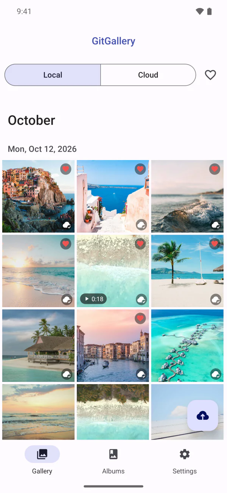
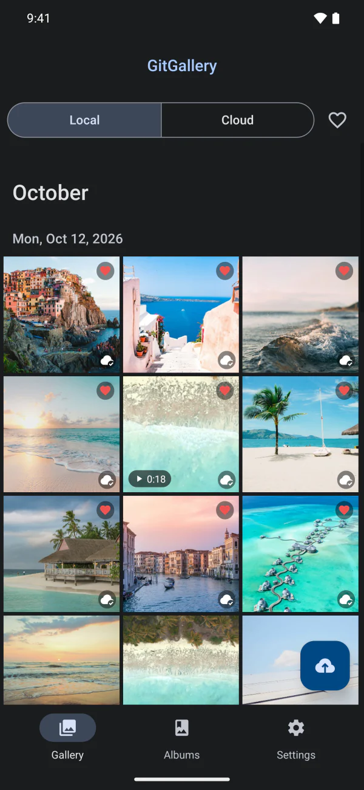
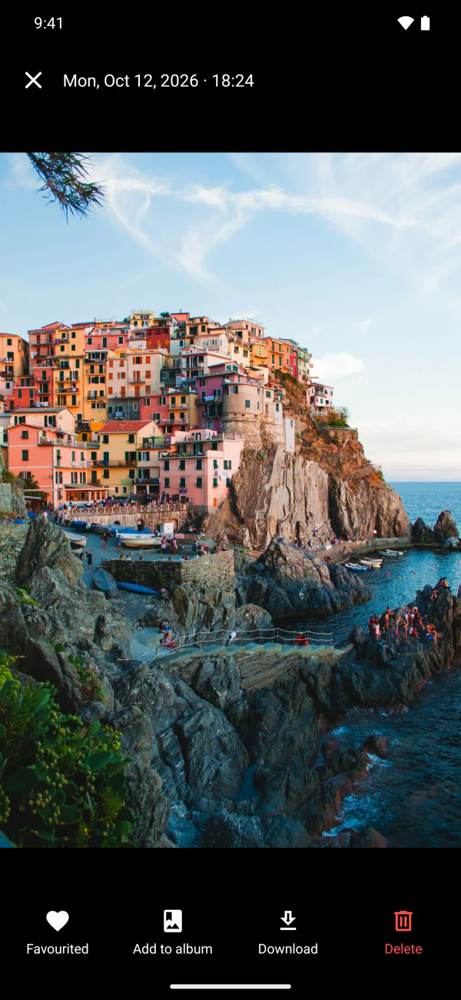
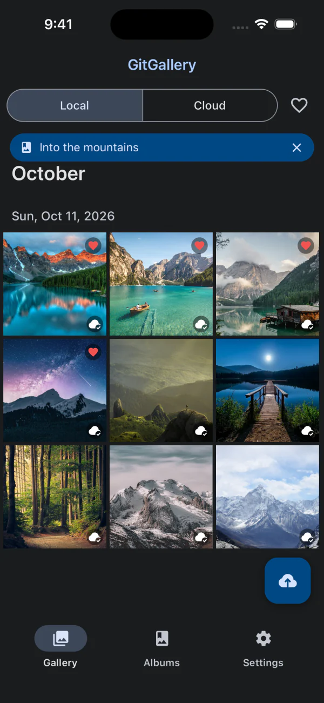
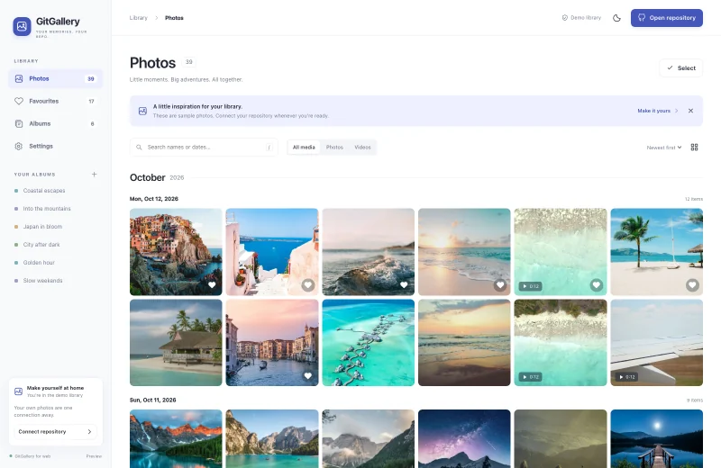

<h1 align="center">GitGallery</h1>

<b>Back up your photos and videos to your own private GitHub repository.</b> 
A beautiful gallery for your memories, stored in a repo that only you own.

  
  &nbsp;
  

  <a href="https://gitgallery-umber.vercel.app"><b>Open the web app</b></a> ·
  <a href="https://gitgallery-umber.vercel.app/?demo=1">Try the demo (no sign-in)</a> ·
  <a href="https://gitgallery-umber.vercel.app/support.html">Help</a>

---

## Why GitGallery

- **Your photos stay yours.** They go straight from your phone to a private repository in *your* GitHub account.
  There is no GitGallery server holding your pictures, and nobody else can see them.
- **No storage plan to buy.** GitHub keeps your library; GitGallery just makes it look and feel like a real photo app.
- **Every device, one library.** Android, iPhone and the web all open the same library, albums included.

## Screenshots

<table>
  <tr>
    <td></td>
    <td></td>
    <td></td>
    <td></td>
  </tr>
  <tr>
    <td align="center">Your timeline</td>
    <td align="center">Dark mode</td>
    <td align="center">Full-quality viewer</td>
    <td align="center">Albums on iPhone</td>
  </tr>
</table>

   
  The web app: your library in any browser.

[See all screenshots](screenshots/README.md)

## Features

- **Automatic backup** of the photos and videos you choose, in original or space-saving quality.
- **A fast timeline** grouped by day, with a smooth full-screen viewer and video playback.
- **Albums** that follow you to every phone you sign in on and to the web app.
- **Share an album by link.** Anyone with the link can view and save the photos, no GitHub account needed. Copies
  are encrypted on your phone, and **Stop sharing** deletes them.
- **Large videos stay fast:** they're stored as release files in your repository (up to 2 GiB each), so your library
  stays quick to load.
- **Favourites, multi-select, download to your phone's gallery**, light and dark mode.
- **Web app** with search, albums, drag-and-drop upload and downloads.
- **Try it first:** a demo library shows how everything works without signing in.

## How it works

1. **Sign in with GitHub.** You approve GitGallery on GitHub's own page; your password never touches the app.
2. **GitGallery finds your library**, or creates a private repository called `gitgallery-photos` for you.
3. **Pick what to back up.** Photos are saved into the repository, sorted by date. Large videos are stored as
   release files in the same repository, so your library stays fast.

## Privacy

- Your photos, videos and GitHub data are **never sent to us** and never used for ads.
- The Android and iPhone apps show **one small banner ad** to keep GitGallery free. In Europe you're asked for consent
  first, and on iPhone you choose whether ads may use your device's advertising identifier.
- Full details: [privacy policy](https://gitgallery-umber.vercel.app/privacy.html).

## FAQ

**Is GitGallery free?**
Yes. It's free to download and use, with a single small banner ad in the mobile apps.

**Do I need to know Git or code?**
No. You only need a free GitHub account. GitGallery does the rest.

**How much can I store?**
GitHub recommends keeping a repository under 1 GB (and under 5 GB at most). GitGallery keeps photos in the repository
and stores large videos as release files (each up to 2 GiB), which don't count toward the repository itself. Very large
libraries can still run into GitHub's limits, so keep that in mind if you shoot a lot of video.

**Why does sign-in ask for access to my repositories?**
GitHub's sign-in for apps like this can only ask for access to all of your repositories, not just one. GitGallery only
reads and writes its own library repository, and you can revoke access any time at
[github.com/settings/applications](https://github.com/settings/applications).

**Can I see my photos without the app?**
Yes. They're ordinary files in your repository, so you can always open or download them on GitHub.

**Something isn't working.**
See [Help](https://gitgallery-umber.vercel.app/support.html) or [open an issue](https://github.com/labmember003/GIt-Gallery/issues).

## For developers

Building GitGallery yourself, the storage design and the project history are in [DEVELOPMENT.md](DEVELOPMENT.md).

---

Google Play and the Google Play logo are trademarks of Google LLC. Apple, the Apple logo and App Store are
trademarks of Apple Inc. GitHub is a trademark of GitHub, Inc. GitGallery is not affiliated with GitHub.
